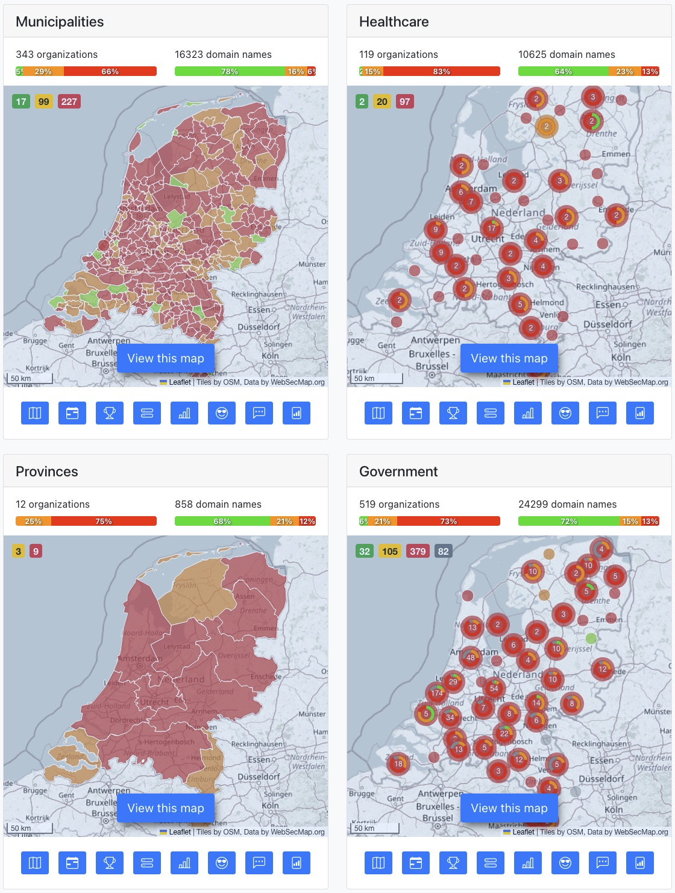
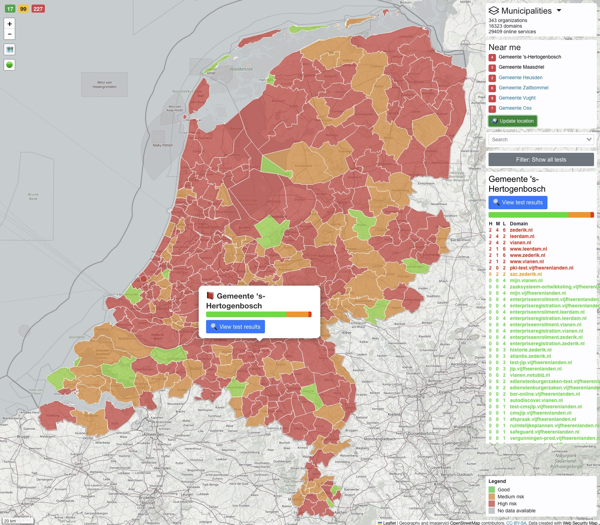
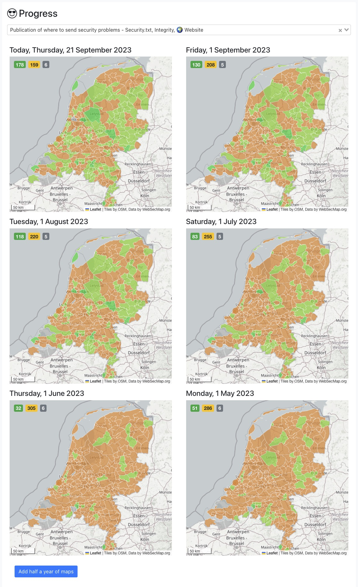
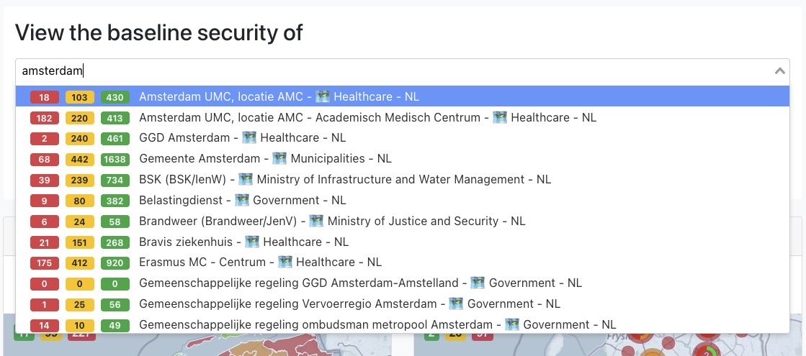
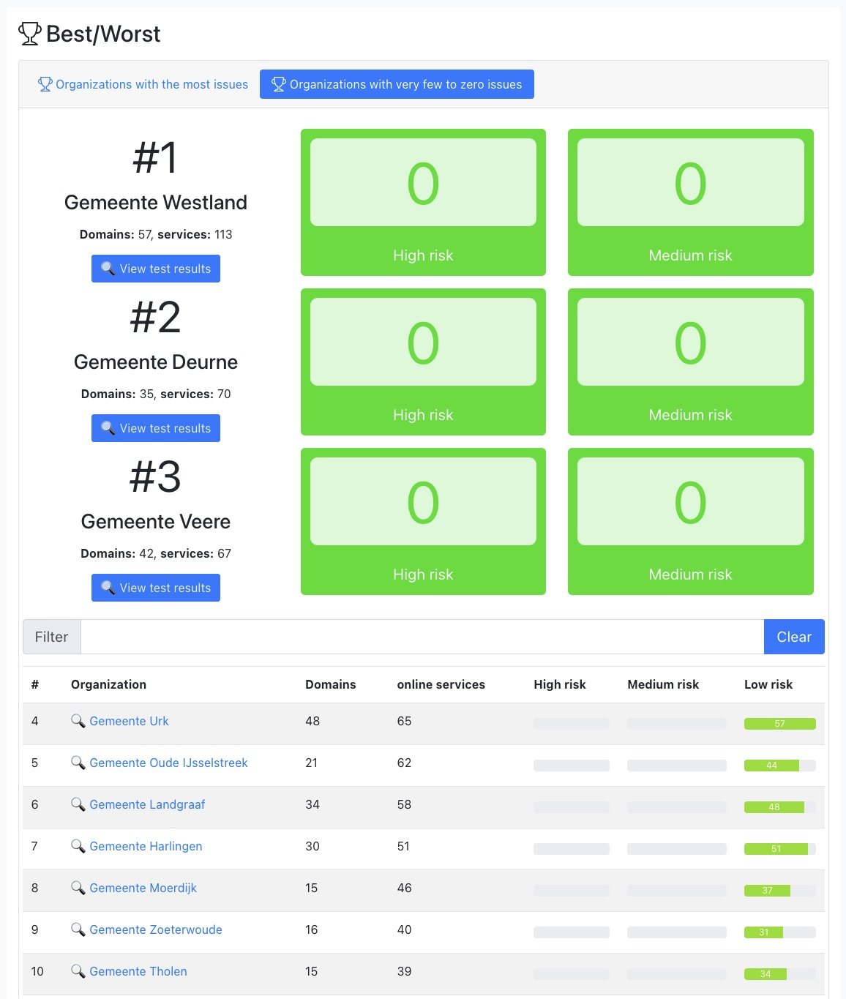
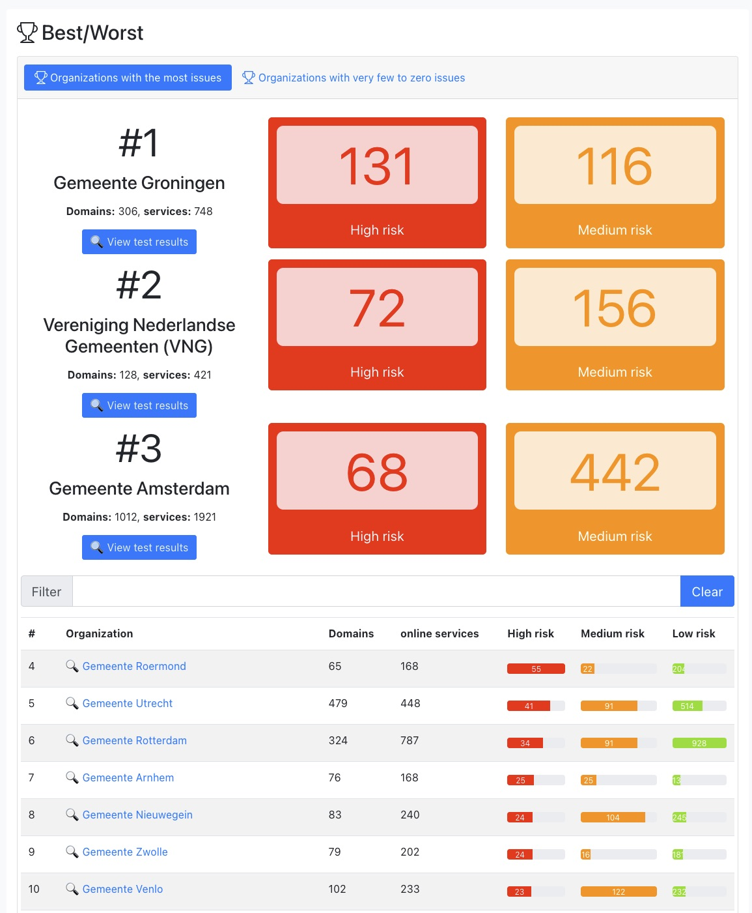
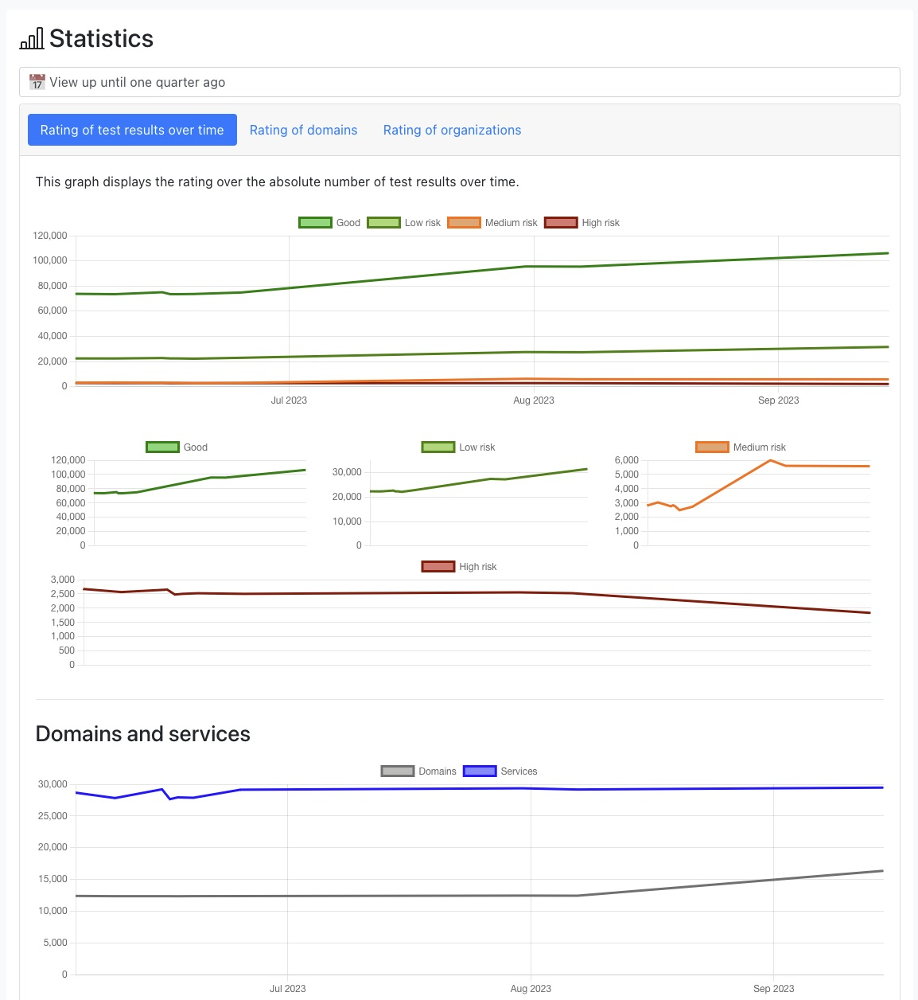
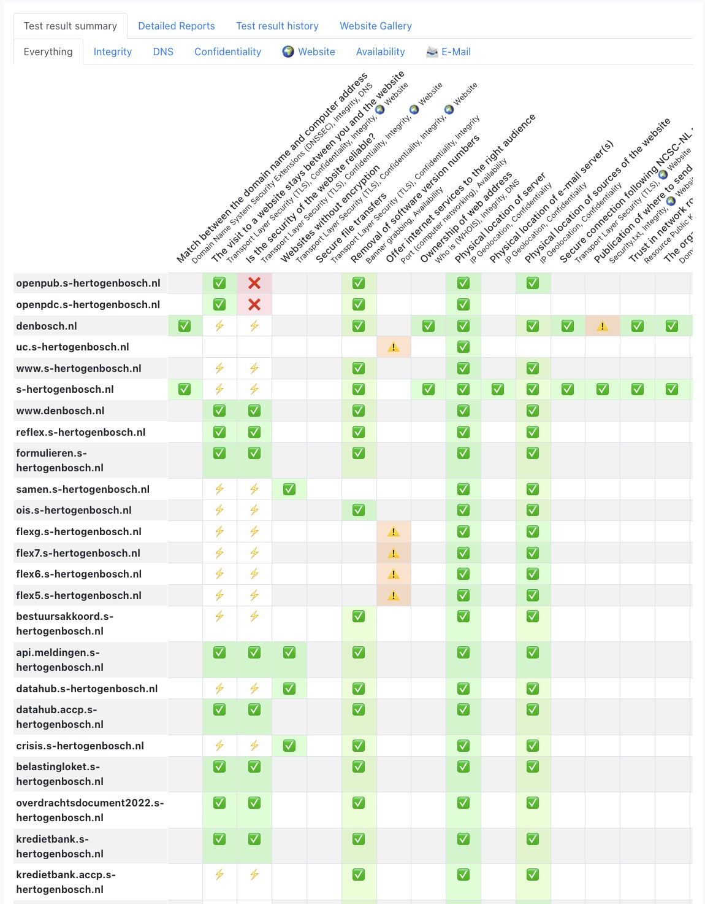
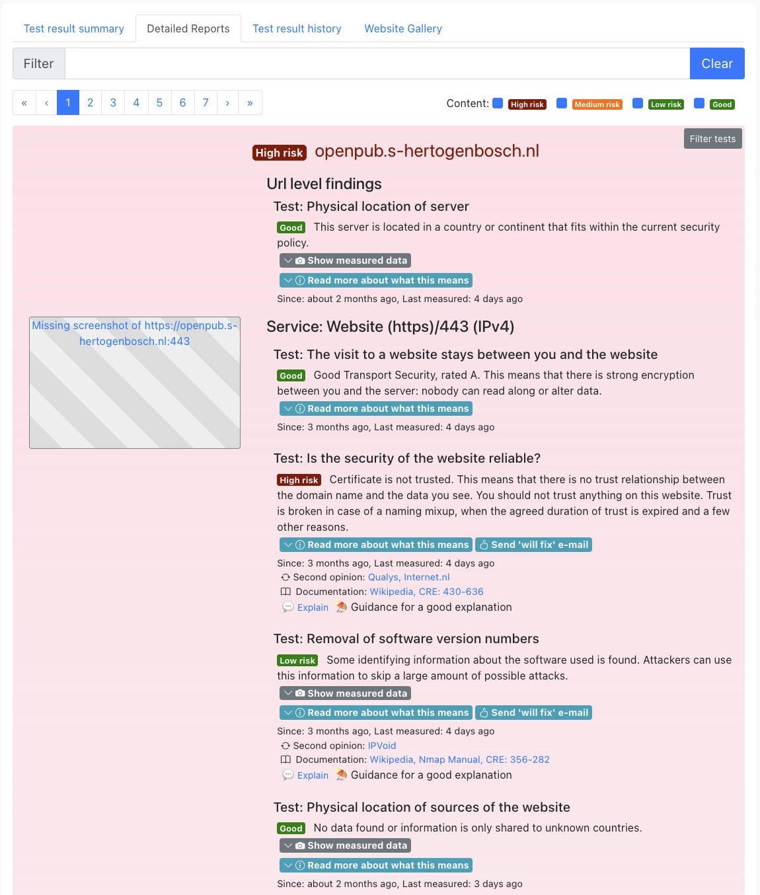
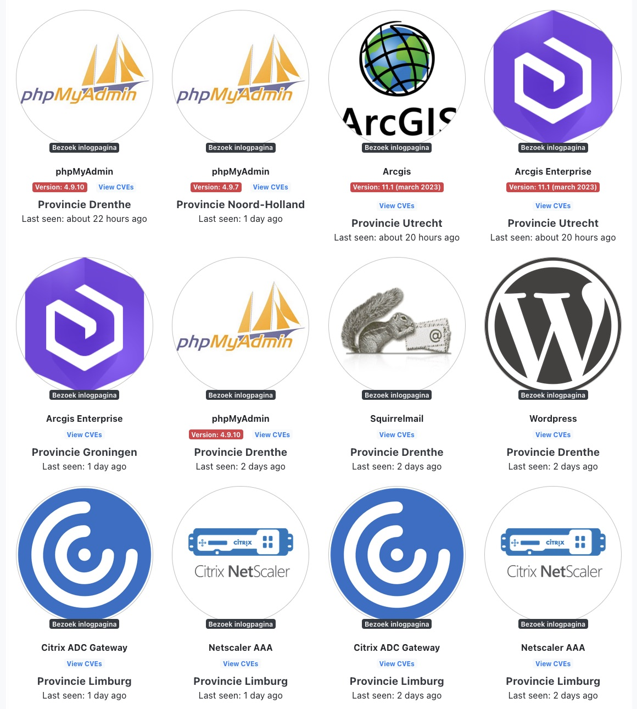

# Web Security Map

[](https://gitlab.com/internet-cleanup-foundation/web-security-map/commits/master)
[](https://shields.io)
[](https://shields.io)
[](https://shields.io)
[](https://shields.io)

## Why Web Security Map

Use Web Security Map to create a tangible view on how well security and privacy practices are applied.

Anyone can understand this map while stakeholders are motivated to solve issues and prove their online proficiency.

Web Security Map uses data from Open Streetmaps and Wikidata, amongst dozens of other public sources of information.

This project is part of public policy:

* The Dutch National Cyber Security Strategy of the Ministry of Justice and Security
  - https://www.ncsc.nl/documenten/publicaties/2022/oktober/10/actieplan-nederlandse-cybersecuritystrategie-2022-2028
* The Dutch Value Driven Agenda Digitization of the Ministry of the Interior and Kingdom Relations
  - https://www.rijksoverheid.nl/documenten/rapporten/2022/11/04/bijlage-1-werkagenda-waardengedreven-digitaliseren

## What is it

Web Security Map is an open source web application that continuously evaluates the implementation of security standards
and best practices at (governmental) organizations.

Here is a short feature overview of what you can do with Web Security Map. Note that all features are available for all
layers. We've chose municipalities as those visualize the best.


Above screenshots: multiple maps showing security of Dutch Municipalities, Dutch Hospitals, Dutch Provinces and the
Dutch Central Government. Green and red map to the colors of a traffic light. Red means there are high risk issues,
orange means medium risk (soon to be red, new metrics), green means no issues.


Above screenshot: map of Dutch Municipalities showing all possible issues together. Note that the current location of
the visitor is used (optionally). In this screenshot there are 17 green, 99 orange and 227 red municipalities. The
metric is very strict: one high risk issue creates a red organization. This is measured on ALL subdomains on over 20
security standards. Thus the ones shown in green are showing true mastery of security.


Above screenshot: Progress report of a single metric. In this case security.txt at Dutch municipalities. The standard
got mandated on May 23 2023. First of may there are 51 correct adoptions. This lowers in June to 32 because of a
stricter check on the file: it needed to end on a new line. In July the adoption rose to 83, 118 in August, September
first was 130 and september 21 it was 178. The steep rise is explained by September being Cyber Security Month for the
government. Which is a good excuse to spend some budget and time on security. This is also the reason there are more
than 10 green municipalities in the above screenshots.


Above screenshot: Search for any organizations accross maps using fuzzy search. Searching for Amsterdam for example
shows not only the municipality but also the local hospital and several organizations that have a presence there. It's
also possible to search for old names of cities, nicknames, subdomains and more.


Above screenshot: a chart showing the best municipal organizations. The number one in the screenshot is "Gemeente
Westland", which has more than 100.000 inhabitants. They have 57 domains and 113 services which are tested frequently.
Everything they do is either correct or (automatically) explained according to common security standards.


Above screenshot: a chart showing the worst municipal organizations. In the screenshot the number one position is taken
by
"Gemeente Groningen", which coincidentally connects to their city slogan: 'there is nothing above Groningen'. Many of
these issues are caused by a configuration error on their side, creating the impression that they lack HTTPS on several
servers. The second place goes to the Association of Dutch Municipalities. They have a security organization on their
own but it seems some politics leaves some older sites to be unmaintained and thus have low security. Most of their
issues could be fixed in little time with little overhaul. The security organization itself has everyting in order. The
third place is the city of Amsterdam, which used to be first place on the top-best-list. The constant flow of new
systems, with over 500 domains already makes it extremely hard to keep up with security standards it seems.


Above screenshot: overall statistics of municipal organizations. This shows trends of all security issues over the past
three months. Here you see a slow decline in high risk issues and an incline in low or good ratings.


Above screenshot: Report overview: each type of issue mapped on every domain in a table view. At the moment of writing
the IPv6 metric of Qualys was unavailable and thus shows some 'test error' icons.


Above screenshot: Every metric is visible with references: documentation and a second opinion test


Above screenshot: it's also possible to gather and show all login portals of the government. Organizations often forget
that the internet is a public place, and thus a login portal can be seen by everyone.

## Installation and training videos

This repository contains the front end application for Web Security Map: the map, scanners and administrative web
interface.

To run a full installation of this software, please use the below videos.

For time indexes on these videos, visit: https://monitoryourgovernment.org/

- How To: Installation: https://youtu.be/yhx0b1k_Ag0
- How To: Import Countries: https://youtu.be/esv6G8hmwpE
- Exploring the admin interface: https://youtu.be/Yjq5klYbQww
- Configuration options: https://youtu.be/LX5_lHgljxY
- Add organizations using Data sets: https://youtu.be/YvK79QGaHTY

## Getting started

Keywords: quickstart, installation

### If you want a (self)hosted setup

As our team is small and we change and work quickly, we've found that documentation was constantly out of date.
Especially regarding first setup. Given the target audience is very limited, we've chosen to help individual
installations with setting up.

If you have some computer systems available we can get you up and running in no time. If you want to still take a shot
for it yourself, see the movies on https://websecuritymap.org.

Please contact us at the email address found here: https://internetcleanup.foundation/about-us/

### If you want a local test or development environment

Please follow these instructions to setup a development environment for Web Security Map:

#### Install OS specific dependencies

The project uses Nix and Devenv.sh to bootstrap an isolated and reproducable development environment. Please follow the
instructions on https://devenv.sh/getting-started/ to install Nix and Devenv.sh. Below is a summary of setup commands
for common OS environments:

- **macOS**

```bash
sh <(curl -L https://nixos.org/nix/install)
nix-env -iA cachix -f https://cachix.org/api/v1/install
cachix use devenv
nix-env -if https://github.com/cachix/devenv/tarball/v0.4
```

- **Linux**

```bash
sh <(curl -L https://nixos.org/nix/install) --daemon
nix-env -iA cachix -f https://cachix.org/api/v1/install
cachix use devenv
nix-env -if https://github.com/cachix/devenv/tarball/v0.4
```

- **Windows (WSL2)**

```bash
sh <(curl -L https://nixos.org/nix/install) --no-daemon
nix-env -iA cachix -f https://cachix.org/api/v1/install
cachix use devenv
nix-env -if https://github.com/cachix/devenv/tarball/v0.4
```

#### Cloning source

In a directory of your choosing, download the project source and enter the directory:

```bash
git clone --recursive https://gitlab.com/internet-cleanup-foundation/web-security-map/ && cd web-security-map/
```

#### Direnv (optional, recommended)

To automatically enter the development shell when entering the project directory install and enable
Direnv: https://direnv.net

Allow this project's `.envrc` file to be automatically loaded when entering the project directory:

```bash
direnv allow
```

#### Building, testing and running the project

Active the Devenv shell (not needed with Direnv):

```bash
devenv shell
```

Running `make` once to create a development Virtualenv and setup the App and its dependencies. Running `make` without
arguments by default also runs basic checks and tests to verify project code quality.

```bash
make
```

After completing successfully Web Security Map development server is available to run:

```bash
devenv up
```

Now visit the [map website](http://127.0.0.1:8000/) and/or the
[admin website](http://127.0.0.1:8000/admin/) at http://127.0.0.1:8000 (credentials: admin:faalkaart).

To fill up the empty installation with some data, use the data included with the following commands:

```bash
websecmap load_dataset development_user
websecmap load_dataset periodic_tasks
websecmap load_dataset development_scandata
websecmap report
```

This will provide some municipalities in the Netherlands with a report and stats.

#### Getting started with development

For development purposes it's possible to run the major components of websecmap separately, as they can be rebooted as
such. After a complete installation, use:

```bash
make run-frontend  # to run the django website
make run-broker  # to run redis (when you need to develop tasks)
make run-worker  # to run a worker that processes tasks from redis
```

Do not forget to restart your worker after altering tasks.

#### Optional Steps

If your shell support tab completion you can get a complete list of supported commands by tabbing `make`:

```bash
make <tab><tab>
```

This shows the current data on the map:

```bash
make rebuild_reports
```

It is possible to start the server without redis and without (re)loading data:

```bash
make devserver args="--no-backend --no-data"
```

Give everyone an F rating!

```bash
https://www.youtube.com/watch?v=a14Y2V5zJlY
```

```bash
https://www.youtube.com/watch?v=eAwq2QV7f1k
```

## FAQ / Troubleshooting

### Missing xcode (mac users)

During installation mac users might get the following error, due to not having xcode installed or updated.

```
xcrun: error: invalid active developer path (/Library/Developer/CommandLineTools), missing xcrun at: /Library/Developer/CommandLineTools/usr/bin/xcrun
```

You can update / install xcode tools with the following command:

```
xcode-select --install
```

Dealing with compiling mysql and other software that uses SSL. You can look at the detailed issue here, mostly
compilation fails because of a missing environment variable.

The LDFLAGS need to point to your openssl installation, for example:
"ld: library not found for -lssl" ->

```bash
set -gx LDFLAGS "-L/usr/local/opt/openssl@3/lib"
set -gx CPPFLAGS "-I/usr/local/opt/openssl@3/include"
```

Note: for this you need the X86 (not the arm64!) openssl, because life is pain. So running your "brew install openssl"
does not work, as that installs to: "/opt/homebrew/opt/openssl/lib/".

On m1 macs you can do:
`arch -x86_64 /bin/bash`  # start an x86 shell, which means homebrew will install in /usr/local/Homebrew
`rm -rf /usr/local/Homebrew/`  # to start a new homebrew, without 'missing taps' and other possible weirdness.
`/bin/bash -c "$(curl -fsSL https://raw.githubusercontent.com/Homebrew/install/HEAD/install.sh)"` taken
from https://brew.sh/
`/usr/local/Homebrew/bin/brew install openssl`  # There you go, now retry.

Fish shell, mac, archx86 ld: library not found for -lzstd, you need the x86 brew:

```bash
arch -x86_64 /usr/local/bin/brew reinstall zstd
set -x LDFLAGS -L/usr/local/Homebrew/Cellar/zstd/
```

If you get issues like these:
OSError: dlopen(/usr/local/lib/libgdal.dylib, 6): Library not loaded: /usr/local/opt/openssl/lib/libssl.1.0.0.dylib
Referenced from: /usr/local/opt/libpq/lib/libpq.5.dylib Reason: image not found

Then look here:
https://github.com/kelaberetiv/TagUI/issues/86

### Missing Docker Daemon (mac users)

While docker is installed using brew in prior steps, you probably want to have a gui controlling docker.

Docker for mac can be downloaded here:
https://download.docker.com/mac/stable/Docker.dmg

You can also visit the docker website and get the link using the time tested Oracle(tm) download strategy, here:
https://hub.docker.com/editions/community/docker-ce-desktop-mac

### Manage NPM modules for the map

npm install --prefix websecmap/map/static/js/vendor [packagename]

The --prefix is the key, and allows for multiple repositories.

## Documentation

Documentation is provided at [ReadTheDocs](http://websecmap.readthedocs.io/).

## Get involved

Internet Cleanup Foundation is open organisation run by volunteers.

- Talk to us via [gitter.im/internet-cleanup-foundation](https://gitter.im/internet-cleanup-foundation/Lobby#).
- Or using IRC: #internet-cleanup-foundation/Lobby @ irc.gitter.im (see https://irc.gitter.im for information)
- E-mail us at: [info@faalkaart.nl](mailto:info@faalkaart.nl),
- Or simply start hacking on the code, open
  an [Gitlab Issue](https://gitlab.com/internet-cleanup-foundation/websecmap/issues/new) or send
  a [Gitlab Merge Request](https://gitlab.com/internet-cleanup-foundation/websecmap.org/merge_requests/new).

## Thanks to

This project is being maintained by the [Internet Cleanup Foundation](https://internetcleanup.foundation). Special
thanks to the SIDN Fonds for believing in this method of improving privacy.

Thanks to the many authors contributing to open software.
